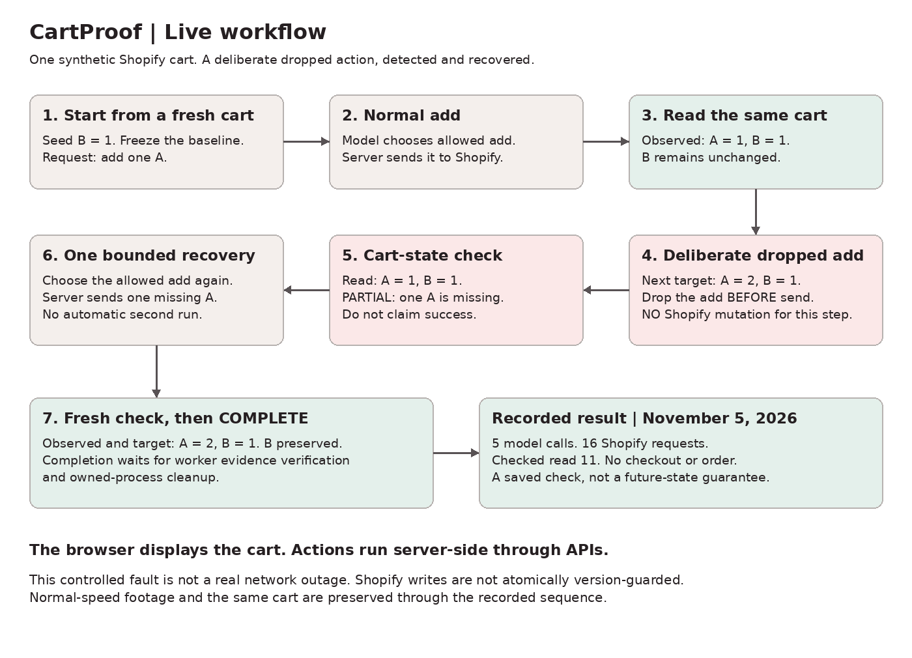
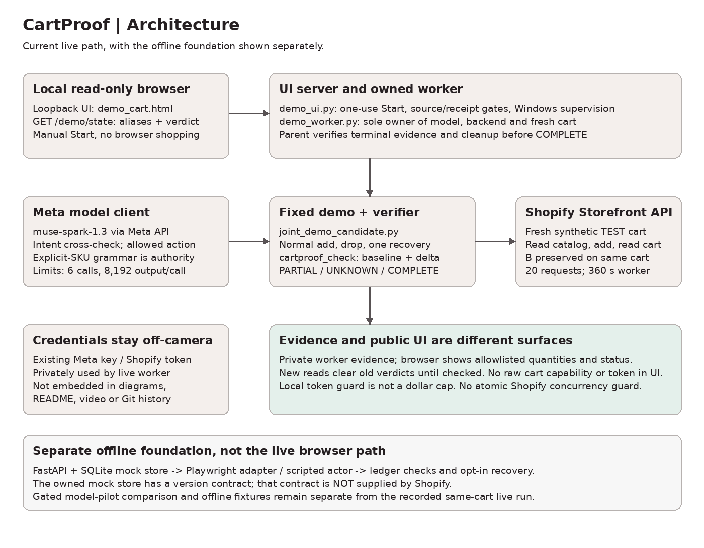

# CartProof

**Check what actually happened. Catch what's missing. Verify the fix.**

A shopping agent can request an action without producing the cart the user wanted. CartProof compares observed cart state with a frozen baseline and the requested change, reports the mismatch, and supports bounded recovery.

[Watch the 92-second live demo](https://drive.google.com/file/d/1vsdhy_eOlS0KsMsBKj1G2mVwE9jdQDMn/view)

The current demo uses real Meta model calls and Shopify Storefront API calls on a fresh synthetic test cart. Its local browser page displays the **same cart** used by the model-selected actions and the verifier. The server executes API actions; this live demo is **not browser-clicking automation**.

## Live workflow



[Edit the workflow in Excalidraw](docs/workflow-live.excalidraw)

1. Create a fresh test cart and seed one B.
2. Cross-check the explicit add-one-A request with the model, then execute its allowed add through Shopify. The cart contains A=1/B=1.
3. For the next add-one-A request, deliberately drop the selected action **before sending a Shopify mutation**. The target is A=2/B=1, but the cart still contains A=1/B=1.
4. Read the cart and report **PARTIAL: missing A x1**.
5. Make one bounded recovery add, read again, and verify A=2/B=1 with B preserved.
6. Publish terminal COMPLETE only after worker evidence and owned-process cleanup pass the parent checks.

This is a controlled demonstration of detection and recovery. The drop is intentional, not a real provider outage. COMPLETE describes the saved checked read, not a guarantee against future cart changes.

## Architecture



[Edit the architecture in Excalidraw](docs/architecture-live.excalidraw)

| Component | Role |
|---|---|
| `harness/demo_ui.py` | Loopback server, one-use Start, reviewed source/receipt gates, Windows worker supervision, terminal verification |
| `harness/demo_worker.py` | Owns the model client, Shopify backend and fresh cart; publishes allowlisted alias-only snapshots |
| `harness/joint_demo_candidate.py` | Fixed normal-add / controlled-drop / one-recovery sequence |
| `harness/shopify_live_backend.py` | Shopify Storefront transport, bounded requests and cart-state reads |
| `store/mcp_server_v2.py` | `run_check` cart-state check against the frozen baseline and requested change |
| `agents/meta_client.py` / `agents/model_client.py` | Meta transport and bounded model calls |
| `harness/demo_browser.py` | Offline browser proof of the actual UI route, states and cleanup |

The model cross-checks intent and selects a constrained allowed action. Deterministic explicit-SKU grammar remains the intent authority. The verifier does not use a model's claim of success as the observed cart state. Checks and actions share the same Shopify backend/cart; this is not a second independent DOM observation of Shopify.

A newer read invalidates the current verdict until that read is checked. The UI distinguishes pending, PARTIAL, UNKNOWN, failure and terminal COMPLETE. Raw tokens and cart capabilities are not part of the browser snapshot.

## What was verified

The recorded live run completed on November 5, 2026:

| Check | Result |
|---|---|
| Provider / model | Meta API, `muse-spark-1.3` |
| Commerce backend | Shopify Storefront API `2026-07`, synthetic TEST variants |
| Final cart | A=2/B=1, existing B preserved |
| Controlled fault | One add dropped before send; no Shopify mutation for that step |
| Recovery | One add of the missing A, followed by a fresh check |
| Usage | 5 model calls, 16 Shopify requests |
| Final checked read | 11 |
| Outcome | Saved live worker evidence verified; parent completion gate passed |
| Exclusions | No checkout, order, customer-data or Admin API operation |

The runtime checkpoint was `b957b14a9e8713472ac6df43d75d7dbc4687f406`, with reviewed source digest `da8fd694c38de5462655032de699d69835c31f23be8ddd7828d7c663f88fcec7`. The current UI offline receipt recorded 122 passing tests. That is focused offline validation, not 122 live API cases or a claim about the entire repository's latest full suite.

Runtime evidence, receipts, credentials and recordings are kept outside Git. The video link is the public-facing explanation; the source and test code show how the gates work.

**Documentation changes and launch identity:** this README is covered by the runtime source manifest. This documentation update does not alter or erase the completed run, but it changes the working-tree closure. The old launch receipt must not be reused to authorize execution of a changed tree. No receipt, source pin or historical evidence is silently regenerated here.

## Limits worth keeping visible

- Shopify writes here have **no atomic cart-version guard**. The check detects state after the fact; it does not make concurrent merchant-side writes atomic.
- This is a fixed synthetic-cart demo, not a general autonomous shopping service or a merchant reliability benchmark.
- The deliberately dropped action proves this controlled case, not recovery from every unknown commit, timeout or outage.
- The browser is a read-only display of server-side API work. The offline mock-store browser adapter is a separate path.
- Demo caps are 6 model calls, 8,192 output tokens per call, a 100,000-token local guard, 20 Shopify requests and a 360-second worker limit. Local token accounting is not a guaranteed dollar cap.
- Worker process ownership and cleanup are checked. Local filesystem checks do not provide immunity to hostile concurrent path replacement. Offline isolation checks are scoped, not complete isolation from every loopback port.
- The live recording does not validate the separate Spark/Wonder model-pilot comparison or establish statistical model superiority.

## Offline foundation

The repository also contains an owned, fault-injectable FastAPI + SQLite storefront, a Playwright adapter, a scripted actor, an intent ledger and opt-in bounded recovery. **These are separate from the live API-driven UI demo above.**

The owned mock store supplies a per-cart version contract. Its verifier can use fresh, settled DOM/API observations and its recovery can make version-guarded corrections. That version contract must not be attributed to Shopify.

Mock faults include silent drop, wrong variant, quantity drift, stale total, DOM/API mismatch, slow consistency and external mutation. Unknown state blocks completion. Recovery is bounded and preserves protected baseline items; uncertain ownership or unknown commit stops rather than guessing.

The gated model pilot (`harness/model_pilot.py`) defines fixed Spark/Wonder profiles, tasks and budgets. Its comparison evidence is distinct from this live same-cart run. The earlier [pilot architecture](docs/architecture.svg) remains available as a separate reference.

## Local setup and offline exploration

The reviewed live worker route is Windows-specific. The commands below are for local installation and the offline foundation, not permission or instructions to make a new paid API attempt.

```powershell
python -m venv .venv
.\.venv\Scripts\python -m pip install -r requirements.txt
.\.venv\Scripts\python -m playwright install chromium
```

Run an owned mock-store task:

```powershell
.\.venv\Scripts\python -m harness.run_task --task examples/task1.json
.\.venv\Scripts\python -m harness.run_task --task examples/task1.json --fault dom-api-mismatch
.\.venv\Scripts\python -m harness.run_task --task examples/task1.json --fault slow-consistency --delay-ms 800
```

Run tests deliberately, as a separate local action:

```powershell
.\.venv\Scripts\python -m pytest
```

The live UI is implemented by `harness.demo_ui`; it does not default to live mode. A fresh live run requires matching reviewed source/tests/browser proof, valid credentials supplied privately, explicit mode and separately approved API/spending scope. Starting the loopback server is not proof that those launch gates or credentials are valid. No unrestricted live command is provided here.

## Repository map

```text
adapter/      Playwright actions and observations for the owned mock store
agents/       Scripted actor, intent handling, bounded clients and Meta transport
core/         Offline ledger, verification and recovery
store/        Mock storefront, backend interfaces and MCP cart checks
harness/      Offline runners, live Shopify demo, UI, supervision and model pilot
tests/        Offline and focused regression tests
docs/         Editable Excalidraw diagrams and GitHub-rendered PNGs
examples/     Example offline task input
```

Never put API keys, Storefront tokens, `.env` files, live cart capabilities, private runtime evidence or recordings in Git. Public source publication and a license choice are separate decisions; this update does not add a license.
